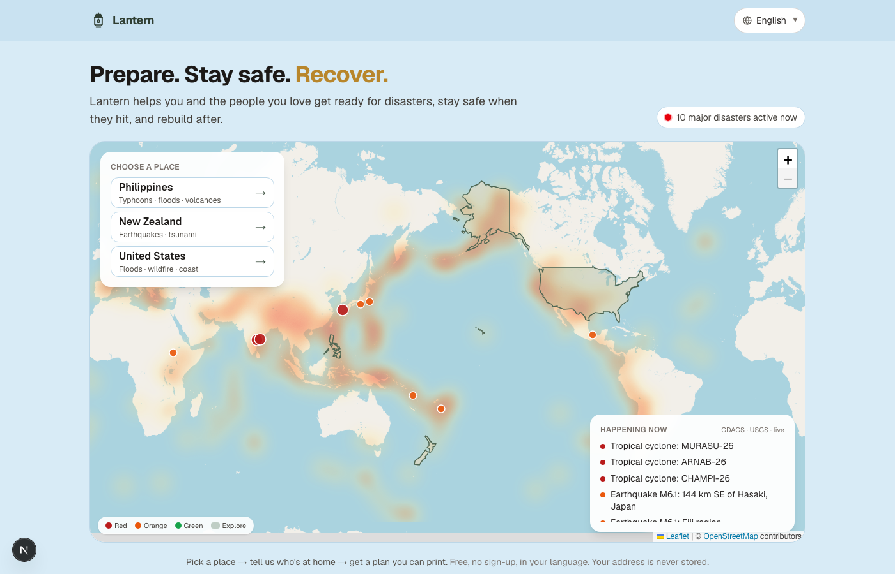
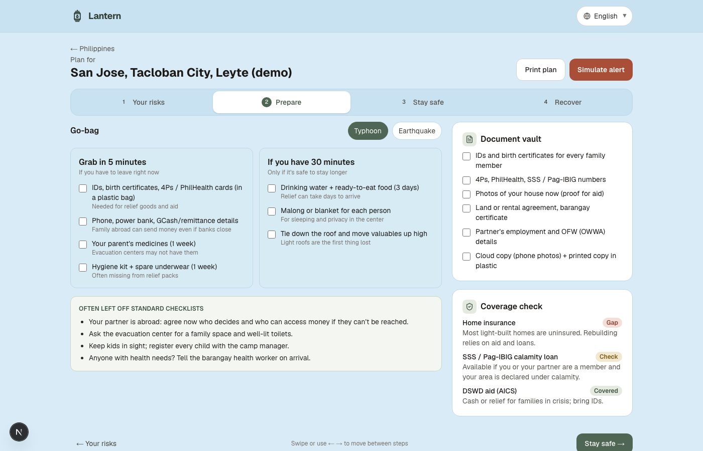

# Lantern

**Prepare. Stay safe. Recover.**

Lantern turns public disaster data into a plain-language plan for you and the people you care for: your real risks, what to pack, when to leave, where to go, and how to recover. It works in your language.

Built for the Women in AI Claude Hackathon (climate track).

**Team:** Caroline Guirgis, Tanaya Salunkhe, Sabrina Cao, Kendall Lobo

**Live demo:** https://lantern-gold-eight.vercel.app

**Demo video:** [Watch the demo (lantern-demo.mov)](https://github.com/tanaya456/lantern/raw/main/docs/lantern-demo.mov)



## The problem

Disaster alerts say *something is coming*. They don't say what **you** should do, given your home, your family and your constraints: no car, a baby, an older relative, a pet, a ground-floor apartment. The risk data exists, spread across a dozen government portals, and none of them turn it into a plan.

## What Lantern does

1. **See risk worldwide.** A live heat map of current disasters (GDACS, USGS). Pick a country to explore.
2. **Understand your place.** Country hazard levels (ThinkHazard!), disaster history since 2000 (EM-DAT), live alerts and, for New Zealand, volcano alert levels (GeoNet).
3. **Search a real US address.** Lantern pulls FEMA's National Risk Index for that census tract, the FEMA flood zone, active National Weather Service alerts, and nearby schools, community centers and hospitals.
4. **Tell us who's at home.** A few optional questions: kids, older relatives, mobility, car, pets, home type, language.
5. **Get a plan in four steps** (swipe or click):
   - **Your risks:** ranked, explained in one sentence each, on a map
   - **Prepare:** go-bag (grab in 5 minutes vs. 30), things checklists often miss, document checklist, insurance gaps
   - **Stay safe:** your personal trigger point (when *you* need to act), evacuation or shelter-in-place steps, map
   - **Recover:** first 72 hours, first 30 days, rebuild, and local aid and loan programs
6. **Simulate an alert.** A "what to do now" message in your language.



**Languages:** English, Español, Tagalog (UI). Te Reo Māori alert line for the New Zealand demo. Non-English text is draft and needs native-speaker review.

**Accessible by design:** plain language, multilingual, keyboard navigable, large tap targets, printable plan, no sign-up, and addresses are never stored.

## Demo households

| Country | Household | Main risks |
|---|---|---|
| Philippines | Tacloban: parent of 3 caring for an elder, partner working overseas | Typhoon, storm surge, flood, earthquake |
| New Zealand | Wellington: solo parent with a toddler, renting | Earthquake, tsunami, landslide |
| United States | Houston (flood), Grass Valley (wildfire), Crescent City (tsunami), or **any real US address** | Varies |

Demo shortcuts: `?c=PHL` · `?p=tacloban&tab=prepare` · `?p=wellington&alert=1` · `?lang=es` · `?tour=1`

## Data sources

| Data | Source |
|---|---|
| Live global disasters | [GDACS](https://www.gdacs.org) (UN / European Commission) |
| Earthquakes | [USGS](https://earthquake.usgs.gov) |
| Country hazard levels | [ThinkHazard!](https://thinkhazard.org) (GFDRR / World Bank) |
| Disaster history | [EM-DAT](https://www.emdat.be) (CRED / UCLouvain), via the Humanitarian Data Exchange |
| US tract-level risk | [FEMA National Risk Index](https://hazards.fema.gov/nri/) |
| US flood zones | [FEMA National Flood Hazard Layer](https://www.fema.gov/flood-maps/national-flood-hazard-layer) |
| US weather alerts | [NOAA National Weather Service](https://www.weather.gov/documentation/services-web-api) |
| NZ volcano levels | [GeoNet](https://www.geonet.org.nz) |
| Address search, nearby places, map tiles | © [OpenStreetMap](https://www.openstreetmap.org/copyright) contributors (Photon search) |
| Country outlines | [Natural Earth](https://www.naturalearthdata.com) |

Every API call has a timeout and falls back to a cached snapshot in `data/`, so the demo works offline. EM-DAT is used under its non-commercial terms. Demo households, simulated shelters and plan text are illustrative and labeled in the app.

## Run it locally

Requires Node 20+.

```bash
npm install
npm run dev
# open http://localhost:3000
```

Refresh the offline data snapshots (with the dev server running):

```bash
python3 -I scripts/cache-data.py
```

## Tech

Next.js (App Router), React, TypeScript, Tailwind CSS, Leaflet / react-leaflet, Leaflet.heat, Lucide icons. Built with [Claude Code](https://claude.com/claude-code).

```
app/page.tsx                 screens: world → country → household → plan
app/api/events               live disasters + heat map (GDACS, USGS)
app/api/country/[iso]        hazard levels (ThinkHazard!), World Bank, GeoNet
app/api/geocode              US address search (Photon / OSM)
app/api/address              FEMA NRI + flood zone + NWS alerts + nearby places
lib/addressRisk.ts           builds a plan from real address data + household
lib/mockData.ts              demo households
lib/i18n.tsx                 EN / ES / Tagalog strings
components/ResultsTabs.tsx   Your risks / Prepare / Stay safe / Recover
```

## What's next

- **More actionable data:** plans written by Claude from the retrieved data, plus live open shelters and official evacuation routes in the US
- **Global expansion:** one or two more high-risk countries, with local partners for data and native-speaker translations
- **Mobile:** installable on any phone, offline plans and SMS alerts

## Disclaimer

Lantern is a prototype. Always follow instructions from local emergency officials. Plans are general information, not official, medical, legal or insurance advice.
